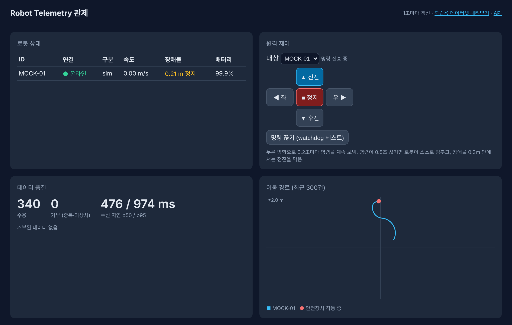

# Robot Telemetry Pipeline + ROS2 Bridge

로봇과 관제 서버를 **양방향으로 실시간 연동**하는 작은 백엔드.
로봇 센서 데이터를 받아 **검증·정제 -> 학습용 데이터셋**으로 만들고, 관제 화면에서 로봇에 **이동 명령**을 보낸다.
ROS2(Humble) TurtleBot3 시뮬레이션 로봇과 연동하며, 실기체 TurtleBot3는 토픽 구조가 같아 브릿지를 그대로 쓸 수 있도록 설계했다.



## 구조

```
[TurtleBot3 (Gazebo)] ⇄ ROS2 토픽 ⇄ [브릿지 노드] ⇄ HTTP ⇄ [FastAPI 관제 서버] ⇄ [관제 화면]
   /odom, /scan  ------------>  10Hz 수집, 1초마다 묶어 전송  -->  검증·중복 제거·저장
   /cmd_vel      <------------  안전장치·watchdog 거친 명령   <--  POST /commands
```

## 무엇을 하나

| 구분 | 구현 |
|---|---|
| 로봇 → 서버 | `/odom`(위치·속도), `/scan`(라이다) 구독 → 서버 형식으로 변환해 전송 |
| 서버 → 로봇 | 관제 화면 버튼 → `POST /commands` → 브릿지가 `/cmd_vel` 발행 |
| 안전장치 | 장애물 0.3m 안에서는 전진 명령 차단 (회전·후진은 허용해 빠져나올 수 있게) |
| watchdog | 명령이 0.5초 끊기면 로봇 자동 정지. 브릿지 종료 시에도 정지 명령 발행 |
| 명령 제한 | 로봇 사양(TurtleBot3 Burger 0.22 m/s)을 넘는 명령은 서버에서 거부 |
| 끊김 복구 | 서버가 죽어도 브릿지가 데이터를 버퍼에 쌓아뒀다가 복구 후 재전송 |
| 중복 제거 | `(robot_id, ts)` 기본키: 재전송으로 같은 데이터가 두 번 와도 한 번만 저장 |
| 데이터 검증 | 스키마 검증 + 물리적으로 불가능한 값 거부, 버린 데이터는 사유와 함께 기록 |
| 관제 화면 | 온라인/오프라인, 장애물 거리, 수신 지연, 이동 경로, 원격 제어 |
| 학습용 내보내기 | `GET /dataset.csv` 검증 통과 데이터만 (`?source=real` 로 실제 데이터만 선택) |

## 주행 로그 → 학습용 데이터셋 (rosbag)

로봇을 조종하면서 녹화한 로그를 **(관측, 행동) 쌍**으로 바꿔 학습용 CSV를 만든다. 사람 조종을 따라 배우는 학습(모방 학습)의 기본 데이터 형식.

- 센서마다 주기가 달라서(odom 약 30Hz, 라이다 5Hz, 명령 5Hz) **10Hz 간격으로 시간 정렬**
- 위치(odom)가 0.5초 넘게 끊긴 구간은 학습에서 제외, 라이다가 끊긴 순간은 빈 값으로 표시
- 명령이 0.5초 넘게 끊기면 행동을 '정지'로 기록 (브릿지 watchdog과 같은 기준)
- 순서가 뒤바뀐 메시지, 같은 시각 중복 메시지는 바로잡고 개수를 품질 리포트로 출력
- ROS 설치 없이 동작 (`rosbags` 라이브러리)

```bash
# 녹화 (로봇을 조종하는 동안, 다른 터미널)
docker compose exec robot bash -c "source /opt/ros/humble/setup.bash && ros2 bag record -o /ws/bags/run1 /odom /scan /cmd_vel"
# Ctrl+C로 녹화 종료 후 변환
pip install rosbags
python scripts/bag_to_dataset.py bags/run1 -o dataset_run1.csv
```

출력 컬럼: `t_s, x, y, yaw, v, w, min_obstacle_m, action_linear, action_angular`

## 검증 결과 (가짜 로봇 `bridge/mock_robot.py`, 같은 브릿지 로직 사용)

- 40초 주행 중 **서버를 7초간 강제 종료** → 기록 388건, 서버 도착 388건, **유실 0건**
- 벽을 향해 계속 전진 명령 → **0.30m 앞에서 안전장치가 정지**
- 명령 끊기 → watchdog이 로봇 정지 (1.5초 뒤 속도 0.0)
- 수신 지연 p50 약 470ms: 1초마다 묶어 보내는 설계 때문 (실시간성이 더 필요하면 전송 주기를 줄이거나 WebSocket으로 변경)
- rosbag 변환: 센서 끊김·순서 뒤바뀜·명령 끊김을 섞은 테스트 로그로 검증
- 테스트 15개 통과 (`pytest -q`)

## 실행

### GitHub Codespaces (권장)
1. 저장소에서 **Code -> Codespaces -> Create codespace** (4코어 설정 포함)
2. 터미널에서:
   ```bash
   docker compose up --build          # 서버 + Gazebo TurtleBot3 (처음 빌드는 5~10분)
   ```
3. 포트 8000이 자동으로 열리면 관제 화면에서 로봇 선택 후 버튼으로 조종
4. 시나리오 자동 실행 (다른 터미널): `python scripts/drive_scenario.py --robot TB3-01`

Gazebo가 무거우면 가짜 로봇으로: `docker compose --profile mock up --build api mock`

### 로컬 (Docker 없이, 가짜 로봇)
```bash
pip install -r requirements.txt
uvicorn app.main:app --reload
python bridge/mock_robot.py          # 다른 터미널
```

### 테스트
```bash
pip install pytest httpx rosbags
pytest -q
```

## 파일

| 파일 | 역할 |
|---|---|
| `app/main.py` | 관제 서버 (수집, 검증, 품질 리포트, 명령 API) |
| `bridge/core.py` | 브릿지 핵심 로직: 변환, 버퍼·재전송, 안전장치, watchdog (ROS 없이 테스트 가능) |
| `bridge/ros_bridge.py` | ROS2 노드: 토픽 구독·발행 |
| `bridge/mock_robot.py` | ROS 없는 가짜 로봇 (같은 core 사용) |
| `launch/sim_with_bridge.launch.py` | Gazebo(화면 없이) + TurtleBot3 + 브릿지 실행 |
| `scripts/bag_to_dataset.py` | rosbag 주행 로그 → 학습용 (관측, 행동) 데이터셋 |
| `simulator.py` | 중복·이상치를 섞어 보내는 데이터 품질 테스트용 |

## 설계 메모

- **라이다는 best effort QoS**로 구독: 몇 개 빠져도 최신 값이 중요하고, 재전송을 기다리면 오히려 늦어짐.
- **네트워크는 별도 스레드**: 서버가 느리거나 죽어도 20Hz 로봇 제어 루프는 멈추지 않음.
- **deadman 방식 제어**: 관제 화면은 버튼을 누르는 동안 0.2초마다 명령을 계속 보냄. 브라우저가 닫히거나 네트워크가 끊기면 명령이 끊기고 watchdog이 로봇을 세움.
- **오래된 명령 무시**: 브릿지가 새로 켜졌을 때 서버에 남아 있던 예전 명령으로 로봇이 움직이지 않게, 명령이 내려진 시각을 기준으로 판단.
- **안전 판단은 로봇 가까이(브릿지)에서**: 서버와 끊겨도 안전장치는 계속 동작.
- 실제(real)와 합성(sim) 데이터를 컬럼으로 구분해, 학습 시 섞을지 나눌지 선택 가능.

## 실기체로 옮길 때 (아직 검증 X)

- 같은 TurtleBot3 실기체: 토픽 이름(`/odom`, `/scan`, `/cmd_vel`)이 같아 `source:=real` 만 바꿔 쓸 수 있도록 설계
- 다른 로봇: 토픽 이름과 `ros_bridge.py`의 메시지 변환 부분만 수정
- 실기체에서 추가로 볼 것: 배터리 토픽(`/battery_state`) 연결, 실제 네트워크 지연에 맞춘 watchdog 시간 조정, 정지 거리 재측정
