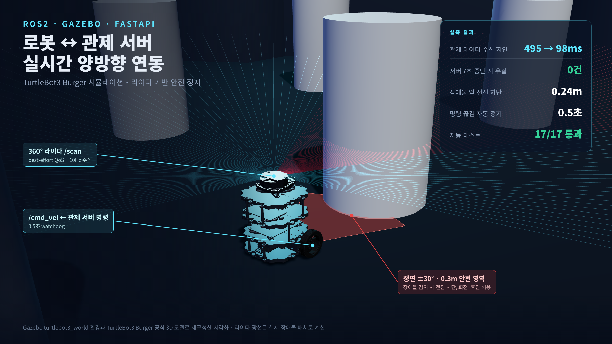
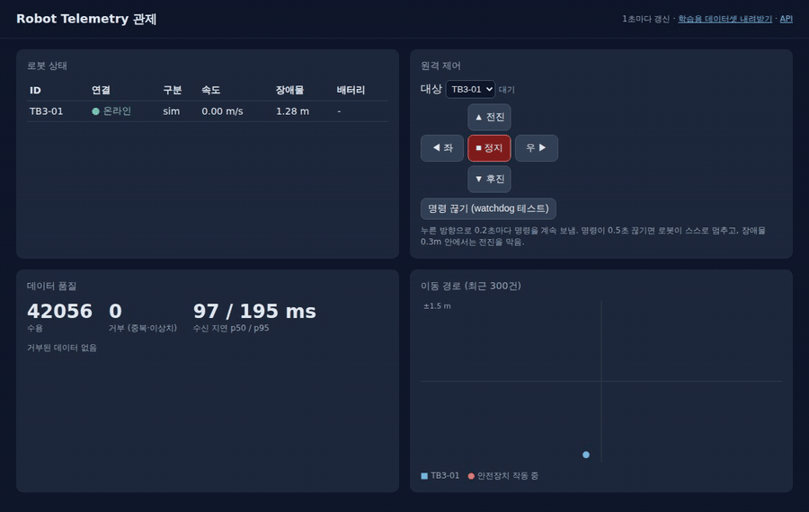
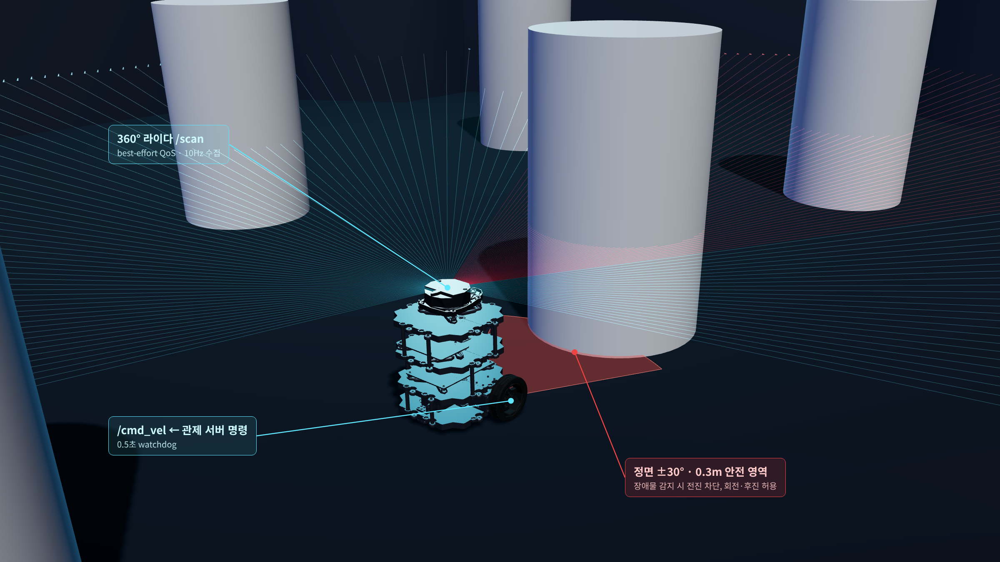
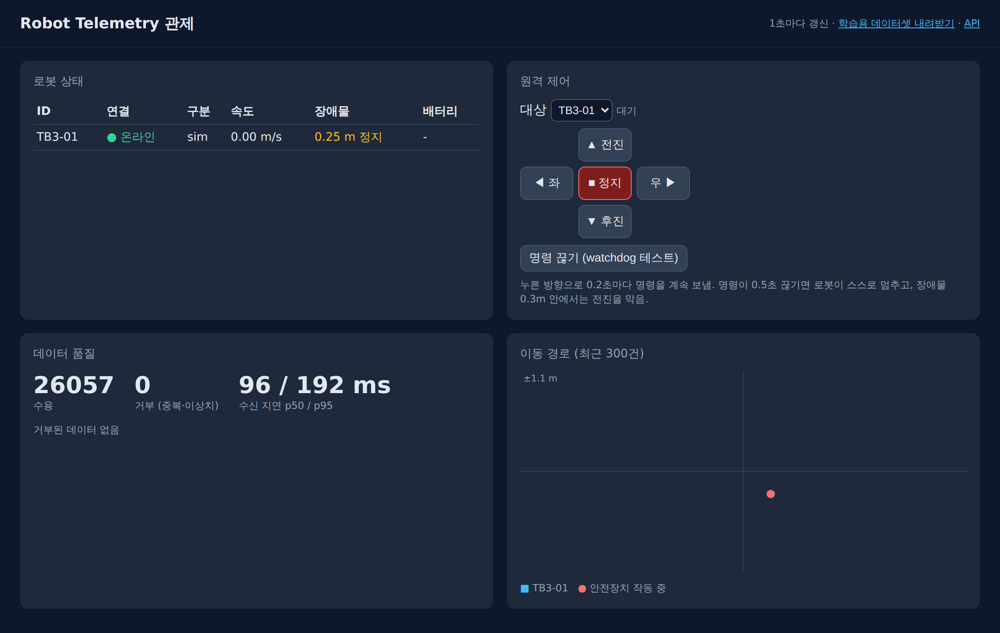

# Robot Telemetry Pipeline + ROS2 Bridge

로봇과 관제 서버를 **양방향으로 실시간 연동**하는 백엔드.
로봇 센서 데이터를 받아 **검증·정제 -> 학습용 데이터셋**으로 만들고, 관제 화면에서 로봇에 **이동 명령**을 보낸다.

ROS2(Humble) + Gazebo의 TurtleBot3 시뮬레이션 로봇과 연동해 검증했다. 실기체에서는 아직 돌려보지 않았고, 실기체 TurtleBot3와 토픽 구조가 같아 브릿지를 그대로 옮길 수 있게 설계했다.





## 구조

```
[TurtleBot3 (Gazebo)] <-> ROS2 토픽 <-> [브릿지 노드] <-> HTTP <-> [FastAPI 관제 서버] <-> [관제 화면]
   /odom, /scan  ------------>  10Hz 수집, 묶어서 전송          -->  검증·중복 제거·저장
   /cmd_vel      <------------  안전장치·watchdog 거친 명령      <--  POST /commands
```

## 무엇을 하나

| 구분 | 구현 |
|---|---|
| 로봇 -> 서버 | `/odom`(위치·속도), `/scan`(라이다) 구독 -> 서버 형식으로 변환해 전송 |
| 서버 -> 로봇 | 관제 화면 버튼 -> `POST /commands` -> 브릿지가 `/cmd_vel` 발행 |
| 안전장치 | **정면 ±30도** 안 0.3m 이내에 장애물이 있으면 전진 차단 (회전·후진은 허용해 빠져나올 수 있게) |
| watchdog | 명령이 0.5초 끊기면 로봇 자동 정지. 브릿지 종료 시에도 정지 명령 발행 |
| 명령 제한 | 로봇 사양(TurtleBot3 Burger 0.22 m/s)을 넘는 명령은 서버에서 거부 |
| 끊김 복구 | 서버가 죽어도 브릿지가 데이터를 버퍼에 쌓아뒀다가 복구 후 재전송 |
| 중복 제거 | `(robot_id, ts)` 기본키: 재전송으로 같은 데이터가 두 번 와도 한 번만 저장 |
| 데이터 검증 | 스키마 검증 + 물리적으로 불가능한 값 거부, 버린 데이터는 사유와 함께 기록 |
| 관제 화면 | 온라인/오프라인, 정면 장애물 거리, 수신 지연, 이동 경로, 원격 제어 |
| 학습용 내보내기 | `GET /dataset.csv` 검증 통과 데이터만, rosbag 주행 로그 -> (관측, 행동) CSV |

## 검증 결과 (Gazebo TurtleBot3, 2026-11-15)

결과 원본은 [`docs/`](docs/)에 있다.

| 항목 | 결과 | 근거 |
|---|---|---|
| 안전 정지 | 장애물 0.244m 앞에서 전진 차단, 명령을 끊으면 1.5초 안에 속도 0 | [scenario.txt](docs/scenario.txt), [사진](docs/screenshots/safety_stop.png) |
| 서버 7초 중단 | 브릿지가 최대 81건을 쌓아뒀다가 복구 직후 재전송. 71건이 최대 9.0초 늦게 도착, 측정 간격 최대 0.101초 (빈 구간 없음 = 유실 0건) | [outage.txt](docs/outage.txt) |
| 수신 지연 | 전송 주기 1초 -> 0.2초: p50 **495ms -> 98ms**, p95 954ms -> 191ms | [전](docs/latency_before.txt) / [후](docs/latency_after.txt) |
| rosbag 변환 | 44초 주행 로그(odom 1,299건, scan 221건, cmd_vel 884건)를 10Hz 학습용 442행으로 정렬, 순서 꼬임·중복 0건 | [bag_report.txt](docs/bag_report.txt), [CSV 앞부분](docs/dataset_head.txt) |
| 자동 테스트 | 17개 통과 | [pytest.txt](docs/pytest.txt) |

| 로봇 쪽 (3D 시각화) | 관제 쪽 (서버 화면) |
|---|---|
|  |  |

같은 상황(정면 장애물 0.26m)을 로봇 쪽과 관제 쪽에서 본 화면.

## 직접 돌려보고 찾아서 고친 문제

1. **장애물 판단 범위.** 처음엔 라이다 360도 전체의 최솟값으로 판단해서, 뒤나 옆의 기둥 때문에 전진이 막혀 로봇이 갇혔다. 정면 ±30도만 보도록 고치고 회귀 테스트를 추가했다 (`front_min_obstacle`).
2. **1초마다 멈추는 현상.** 로그에서 명령이 정확히 1초 간격으로만 들어오는 것을 발견했다 ([watchdog_log.txt](docs/watchdog_log.txt)). 브라우저를 빼고 서버 안에서 같은 명령을 0.2초마다 보내는 실험을 해보니 현상이 사라졌다. 원인은 가려진 브라우저 창이 반복 작업을 1초 단위로 늦추는 동작이었다. 조작 화면이 안 보이면 로봇이 멈추는 건 안전상 맞는 동작이지만, 실제 관제라면 조작자에게 경고를 띄워야 한다.
3. **수신 지연.** 전송 주기를 ROS 파라미터(`upload_period_s`)로 빼고 1초에서 0.2초로 줄여 지연을 약 5분의 1로 낮췄다. 대신 서버 요청이 5배 늘어나므로, 로봇 수가 많아지면 주기를 늘리거나 WebSocket으로 바꾸는 것이 맞다.

같은 과정에서 구조도 손봤다. 명령 확인과 데이터 전송을 **별도 스레드로 분리**해 서버가 느려져도 명령 확인이 멈추지 않게 했고, 데이터가 쌓여도 조회가 느려지지 않게 **DB 인덱스와 WAL 모드**를 넣었다.

## 주행 로그 -> 학습용 데이터셋 (rosbag)

로봇을 조종하면서 녹화한 로그를 **(관측, 행동) 쌍**으로 바꿔 학습용 CSV를 만든다. 사람 조종을 따라 배우는 학습(모방 학습)의 기본 데이터 형식이다.

- 센서마다 주기가 달라서(odom 약 30Hz, 라이다 5Hz, 명령 20Hz) **10Hz 간격으로 시간 정렬**
- 위치(odom)가 0.5초 넘게 끊긴 구간은 학습에서 제외, 라이다가 끊긴 순간은 0으로 채우지 않고 빈 값으로 표시
- 명령이 0.5초 넘게 끊기면 행동을 '정지'로 기록 (브릿지 watchdog과 같은 기준)
- `/cmd_vel`은 조작자가 누른 명령이 아니라 **안전장치를 거쳐 로봇이 실제로 받은 명령**이라, 이 데이터로 학습하면 장애물 앞 정지까지 함께 배운다
- 순서가 뒤바뀐 메시지, 같은 시각 중복 메시지는 바로잡고 개수를 품질 리포트로 출력
- ROS 설치 없이 동작 (`rosbags` 라이브러리)

```bash
# 녹화 (45초 뒤 자동 종료)
docker compose exec -d robot bash -c "source /opt/ros/humble/setup.bash && timeout -s INT 45 ros2 bag record -o /ws/bags/run1 /odom /scan /cmd_vel"
# 변환
python scripts/bag_to_dataset.py bags/run1 -o dataset_run1.csv
```

출력 컬럼: `t_s, x, y, yaw, v, w, min_obstacle_m, action_linear, action_angular`

## 3D 시각화 (`viz/`)

README와 포트폴리오에 쓰는 3D 이미지(`docs/screenshots/3d_*.png`)를 만드는 코드.

- 로봇: ROBOTIS 공식 TurtleBot3 Burger 3D 모델(`viz/assets`, Apache-2.0)을 URDF의 부품 위치 그대로 배치
- 맵: Gazebo `turtlebot3_world` 모델 파일의 기둥·장애물·외벽 좌표와 크기
- 라이다: 라이다 위치에서 1도 간격 360개 광선을 맵 장애물에 쏴서 계산 (최대 3.5m)
- 빨간 부채꼴: `bridge/core.py`의 판단 기준 그대로 (정면 ±30도, 0.3m)
- 로봇 위치: 정면 기둥까지 0.26m, 안전장치 테스트 화면(`safety_stop.png`)의 측정값과 같게

주행 로그를 재생하는 화면이 아니라, 시뮬레이션 환경과 안전장치 규칙을 그대로 옮긴 정적 시각화다.

```bash
python viz/render.py     # -> docs/screenshots/3d_hero.png, 3d_safety_stop.png
```

## 실행

### GitHub Codespaces (권장)
1. **Code -> Codespaces -> New with options -> 4-core**로 생성
2. 터미널에서:
   ```bash
   docker compose up -d --build     # 서버 + Gazebo TurtleBot3 (처음 빌드는 5~10분)
   ```
3. PORTS 탭에서 8000번을 열면 관제 화면. 로봇(TB3-01)을 선택하고 버튼으로 조종
4. 시나리오 자동 실행: `python scripts/drive_scenario.py --robot TB3-01`
5. 관제 화면 캡처 (화면 캡처가 막힌 환경용): `python scripts/snap.py 이름`

Gazebo가 무거우면 가짜 로봇으로: `docker compose --profile mock up --build api mock`

### 로컬 (Docker 없이, 가짜 로봇)
```bash
pip install -r requirements.txt
uvicorn app.main:app --reload
python bridge/mock_robot.py          # 다른 터미널
```

### 테스트
```bash
pip install pytest httpx rosbags
pytest -q
```

## 파일

| 파일 | 역할 |
|---|---|
| `app/main.py` | 관제 서버 (수집, 검증, 품질 리포트, 명령 API) |
| `bridge/core.py` | 브릿지 핵심 로직: 변환, 정면 장애물 판단, 버퍼·재전송, 안전장치, watchdog, 통신 스레드 (ROS 없이 테스트 가능) |
| `bridge/ros_bridge.py` | ROS2 노드: 토픽 구독·발행, 파라미터(`robot_id`, `source`, `server_url`, `upload_period_s`) |
| `bridge/mock_robot.py` | ROS 없는 가짜 로봇 (같은 core 사용) |
| `launch/sim_with_bridge.launch.py` | Gazebo(화면 없이) + TurtleBot3 + 브릿지 실행 |
| `scripts/drive_scenario.py` | 전진 -> 회전 -> 명령 끊기 시나리오로 안전장치·watchdog 확인 |
| `scripts/bag_to_dataset.py` | rosbag 주행 로그 -> 학습용 (관측, 행동) 데이터셋 |
| `scripts/snap.py` | 관제 화면을 PNG로 저장 |
| `viz/scene.html`, `viz/render.py` | TurtleBot3 3D 시각화와 PNG 렌더 |
| `docs/` | 검증 결과 원본 (로그, 리포트, 스크린샷) |

## 설계 메모

- **라이다는 best effort QoS**로 구독: 몇 개 빠져도 최신 값이 중요하고, 재전송을 기다리면 오히려 늦어짐.
- **안전 판단은 로봇 가까이(브릿지)에서**: 서버와 끊겨도 안전장치는 계속 동작. 서버의 속도 상한 검사와 두 겹으로 막는 구조.
- **deadman 방식 제어**: 관제 화면은 버튼을 누르는 동안 0.2초마다 명령을 계속 보냄. 명령이 끊기면 watchdog이 로봇을 세움.
- **오래된 명령 무시**: 브릿지가 새로 켜졌을 때 서버에 남아 있던 예전 명령으로 로봇이 움직이지 않게, 명령이 내려진 시각을 기준으로 판단.
- **보낸 뒤에만 지우기**: 버퍼는 전송에 성공한 다음에만 비움. 응답을 못 받아 다시 보낸 데이터는 서버의 기본키가 중복을 막음.
- 실제(real)와 합성(sim) 데이터를 컬럼으로 구분해, 학습 시 섞을지 나눌지 선택 가능.

## 실기체로 옮길 때

- 같은 TurtleBot3 실기체: `source:=real` 만 바꾸면 토픽 이름이 같아 그대로 동작하도록 설계
- 다른 로봇: 토픽 이름과 `ros_bridge.py`의 메시지 변환 부분만 수정
- 실기체에서 추가로 확인할 것: 배터리 토픽(`/battery_state`) 연결, 실제 네트워크 지연에 맞춘 watchdog 시간, 정지 거리 재측정, 후방 장애물 확인(지금은 후진을 막지 않음), 실기체 제어 코드가 C++(rclcpp)인 경우의 연동
